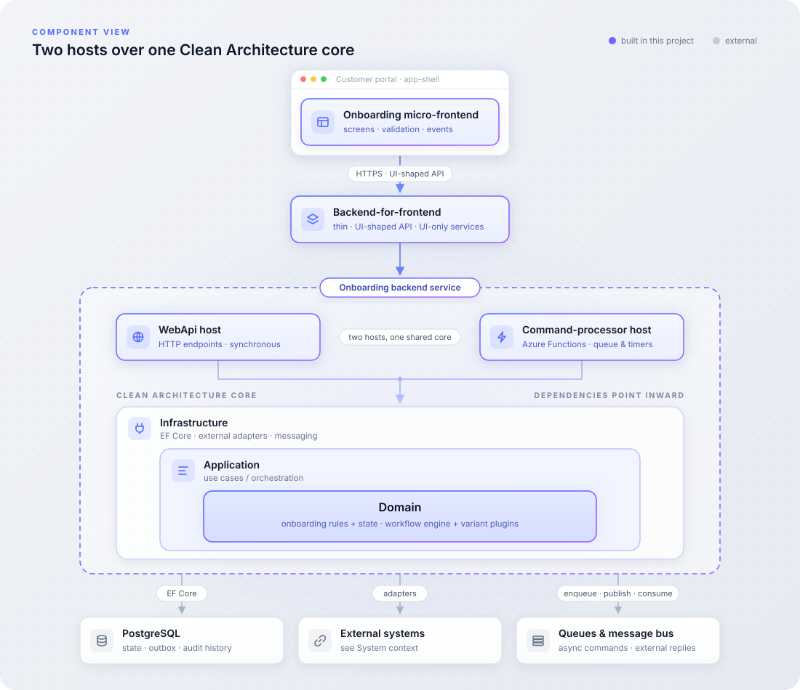
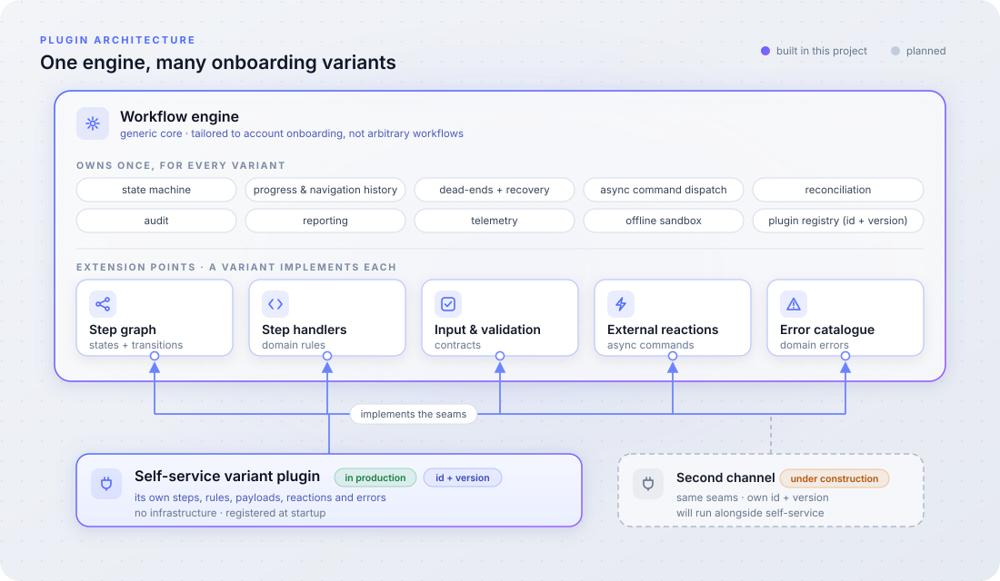

[← Ondřej Maléř · all projects](https://ondmal.github.io)

# Account Onboarding Service

A backend **platform for account onboarding** — a workflow engine tailored to
the onboarding domain that owns it once and runs each onboarding **channel** as
a variant on one shared core. The first channel, **self-service**, is delivered
end to end: React micro-frontend → BFF → service.

**Role:** solution architect and senior developer — designed the whole system
and implemented the most critical parts of it.

**System of record for the *process*, not the account.** The service owns the
**onboarding process** — a journey's state from entry up to account creation.
Once the account exists in the **master account registry** (the primary,
authoritative account system), that registry owns it and the workflow is
finished; the service remains the record of *how* a customer was onboarded,
never of the account itself.

---

## The problem

Onboarding a customer into an account is **not a single flow**. It happens
through different **channels** — a customer doing it themselves, an agent doing
it on their behalf, partner-driven sign-up, bulk migration — and new channels
keep appearing. Building each channel's onboarding from scratch means
re-solving the same hard parts every time — the cross-cutting plumbing (external
systems, durable at-least-once async work, audit/reporting/telemetry, progress
tracking and recovery) **and** the core onboarding business logic itself
(company identification and verification, existing-customer checks, lead
creation, hand-off to account creation) — re-implemented and drifting apart channel by channel.

So the problem is **two-level**:

1. **Build a platform that owns the account-onboarding domain once** — a
   workflow engine, tailored to this domain, that absorbs every recurring
   concern so a new channel implements only its own steps. Channels are
   versioned and can run side by side.
2. **Deliver the first channel on it — self-service** — a fully digital flow a
   customer completes on their own, turning an authenticated visitor into a
   live, provisioned account: company identification and verification, then
   creation and provisioning across several external systems.

The hard part, shared by every channel, lies *around* the interactive flow
rather than in it: side-effects in other systems (lead creation, engagement
events) must be delivered reliably even when those systems are slow or fail
transiently; the account creation handed to the process orchestration system
must be tracked to its real outcome, which may arrive minutes later; and through
all of it the customer must see a coherent, truthful state — with no manual
intervention to get a process unstuck.

---

## System context

The diagram shows the **self-service channel** realising the platform: its three
tiers — micro-frontend, BFF, and backend service — and the specialised external
systems the service integrates with, each reached through its own adapter. Other
channels reuse the same service (engine, domain, provisioning) behind their own
entry points.

---

## Technology

| Area | Choices |
|---|---|
| Frontend | React onboarding micro-frontend (MFE) embedded in a portal app-shell |
| Language / platform | C# / .NET |
| Style | Clean Architecture + DDD; plugin architecture; asynchronous, command-driven processing |
| Persistence | PostgreSQL via EF Core |
| Hosting / runtime | Azure; Kubernetes (both hosts containerised via Helm) |
| Async & messaging | Azure Functions worker (queue- & timer-triggered) on an Azure Storage Account (Queues, Blob, timers); message bus for asynchronous replies from external systems |
| Integration | Port/adapter clients to external systems, centralised resiliency |
| Auth | OAuth / OpenID Connect, token-based service-to-service calls |
| Observability | OpenTelemetry (traces, metrics, logs) exported to Honeycomb; dashboards & SLOs |
| Testing | Unit, integration (mocked externals), end-to-end saga tests |

---

## Highlights

- **A domain-tailored workflow engine with variant plugins.** The self-service
  channel is one plugin, in production; a second channel is being built on the
  same engine. → *Plugin architecture*
- **One Clean Architecture core, two hosts.** A synchronous WebApi host and an
  asynchronous command-processor host run the same Domain → Application →
  Infrastructure stack. → *Component view*
- **Reliable asynchronous processing.** Transactional outbox, durable
  at-least-once transport, idempotent commands, and two-layer reconciliation —
  no process is lost or left stuck. → *Design decisions*, *How the long-running
  process is handled*
- **Cloud-native runtime.** Azure, Kubernetes, Azure Functions, Storage Queues,
  managed PostgreSQL. → *Runtime & infrastructure*
- **Observable, tested, documented.** OpenTelemetry end to end, end-to-end saga
  tests on an offline sandbox, and a full documentation set. → *Observability*,
  *Quality & delivery*

---

## Design decisions

**Reliability over scale.** Traffic is low — tens to a hundred applications a
day, tens of thousands of API requests, a few thousand processed commands — and
the domain does not need more. The architecture is therefore built for
correctness and reliability first: a process must never be lost, and every
choice below favours that over raw throughput. Both hosts are stateless and
scale out independently, but scale was never the driver.

**DDD and Clean Architecture rather than vertical slices.** Onboarding is not
a set of independent features; it is one state machine whose steps all operate
on the same aggregate under the same rules. Vertical slices would scatter that
shared logic — the engine, navigation, recovery, audit, async reactions — across
slices and couple each variant to infrastructure. Keeping a single
infrastructure-free domain, wrapped by Application and Infrastructure, puts the
whole workflow in one testable place, lets two hosts run the same core, and
lets a variant plugin be pure domain code against the engine's extension
points.

**A specialised engine, not a workflow platform.** The engine serves the
**UI-driven part** of the journey — collecting and verifying data, moving back
and forth between steps — where every state change is synchronous and driven by
the customer. The fully automated part — creating and provisioning the account
across many systems — is not re-implemented: it is handed to the external
process orchestration system, and the engine keeps its state in step with that
system's status. What remains is small and well-bounded — every variant is the
same journey, *create an account and bring the customer in* — so a purpose-built
engine, distilled from earlier onboarding implementations, stays simpler to own
than a general workflow platform configured down to one use. No second workflow
runtime, no compensation logic.

**Storage Queues rather than a message broker.** The platform needs no ordered
command execution, and it already supports command replies and deferred
commands, so a plain queue is sufficient; a full broker (Azure Service Bus)
would add cost without a capability the domain uses. The transport sits behind
a port, so switching is an adapter and configuration change, not a redesign.

**Transactional outbox rather than direct enqueue.** A command is written to an
outbox table in the same transaction as the state change it reacts to, published
to the queue after commit, and recovered by a timer-driven publisher if the
immediate publish failed; a message past its time-to-live is dead-lettered as an
explicit data-loss event. No state change commits without its reactions, and no
reaction runs without its state change.

**No Redis.** The one place a distributed cache would serve — command
de-duplication — is a pluggable first-level filter, currently backed by an
in-memory cache per instance. Correctness never depends on it: handlers are
idempotent, so a duplicate that slips past one instance's cache is still
processed safely. At today's traffic Redis would add cost and an operational
dependency without adding a guarantee; the extension point is in place and the
backing store is configuration, not a redesign.

---

## Component view

**Frontend.** The customer-facing experience is an **onboarding micro-frontend
(MFE)** hosted in a shared portal *app-shell*. It renders the step-by-step flow,
validates input client-side, and emits analytics events — but is intentionally
*shape-only*: it holds no business rules, and every decision lives behind the
BFF.

**Clean Architecture, two hosts over one core.** The service follows **Clean
Architecture** with DDD layering: **Domain** (onboarding rules and state, free
of infrastructure) at the centre, wrapped by **Application** (use cases /
orchestration), then **Infrastructure** (persistence, messaging, external
adapters). Dependencies always point inward, so the business rules stay
infrastructure-free and testable in isolation.

Two **hosts** sit on top of that same core as entry points: the **WebApi host**
(HTTP endpoints) and the **command-processor host** (the async worker). The
command processor is **not a thin shim** — it runs commands through the *full*
Domain → Application → Infrastructure stack, exactly like the WebApi host. The
two differ only in how work arrives: a synchronous HTTP request versus a
dequeued command.

**Backend-for-frontend (BFF).** A thin layer between the UI and the core
service: it exposes the *UI-shaped API*, forwards onboarding calls to the
service, and adds the few services only the UI needs (address auto-suggestion,
for example) — so the core stays channel-neutral and other channels can bring
their own front-ends. Sign-in goes through the portal's identity provider
(OAuth / OIDC), and every application-scoped endpoint enforces that the caller
owns the application it addresses; the solution has been penetration-tested.

---

## Plugin architecture

The core is a *workflow engine* — steps, transitions, and state — that
**absorbs, once, everything every onboarding journey needs** and defines a
**fixed set of extension points (seams)** — the contracts a variant must
satisfy — saying nothing else about any specific flow. The bar is deliberate:
*generic across onboarding variants — not arbitrary workflows.* A **variant
plugin** implements those seams with its own onboarding steps and rules.
Plugins are discovered and registered at startup by **id + version**, so
several variants — and several versions of the same variant — can run **side by
side** without touching the engine or one another.

A plugin supplies only domain-specific pieces — its step graph, step
handlers/rules, input & validation contracts, external reactions (the async
commands a step triggers), and its error catalogue. Everything in the engine's
list above it inherits for free, so adding a variant is domain code against the
seams, not infrastructure.

---

## How the long-running process is handled

The picture shows the **self-service variant**. Each variant defines its own
steps and their order; what the engine provides to all of them is the pattern —
synchronous steps, side-effects in the background, and asynchronous observation
only where an external system owns the outcome. In self-service, the journey
has two phases, and the UI is asynchronous only in the second.

- **Phase 1 — interactive steps, synchronous.** The customer collects and
  verifies data and moves back and forth between steps; every transition
  happens inside the request, so the UI never waits on a queue. A step's
  **side-effects** (CRM lead, engagement events) run in the background and never
  block it. A step can also end the journey in a logical **dead-end** (a
  terminal, customer-visible outcome) — for example, a company without a VAT
  number — and sales is notified to follow up.

- **Phase 2 — account creation, observed.** The final submit starts account
  creation in the external process orchestration system. From here the UI
  polls: until the outcome is known, the API returns a *"not ready yet"*
  snapshot — a normal response, never a misleading error. The status arrives later on the message bus, is correlated
  to its process, and the journey ends in a created account or a **dead-end**
  (a terminal, customer-visible outcome). Nothing is compensated, because
  nothing irreversible happens while the customer is in the flow.

- **Nothing lost, nothing stuck.** All background work — the side-effects and
  the account-creation request alike — runs as commands, enlisted through the
  transactional outbox (see *Design decisions*) and executed by the worker host.
  Delivery is at-least-once and commands are idempotent, so a replayed command
  or a duplicated reply converges to the same result. A **deferred reconcile
  command** per pending operation completes it once its reply has landed; a **periodic sweep** is the backstop after a quiet
  period. Messages that expire or fail permanently are dead-lettered as explicit
  data-loss events, never dropped silently.

---

## Runtime & infrastructure

Deployed on **Azure**, running on **Kubernetes** — both hosts are containerised
and rolled out via Helm, with configuration and secrets supplied by the
environment rather than baked into the image.

- **Two hosts, one database.** The WebApi host runs as a plain container; the
  command-processor host is an Azure Functions container with queue-triggered
  command handlers and timer-triggered functions for the outbox publisher and
  the reconciliation sweep. Both scale and roll **independently** over a shared
  managed PostgreSQL.
- **Durable transport.** An Azure Storage Account provides the queues (each
  async command type maps to its own), the blob leases the Functions host needs,
  and the timers; an unmapped command type dead-letters rather than vanishing.

---

## Observability & operability

- **OpenTelemetry end to end** — traces, metrics, and logs with a consistent
  span-and-baggage convention and propagated context, so one onboarding journey
  reads as a single connected story across the BFF, the service, the worker, and
  the downstream calls.
- **Dashboards, SLOs, and runbooks** derived from that instrumentation, closing
  the loop from code → metric → alert → operator action.

---

## Quality & delivery

- **Domain-first, spec-driven development**: behaviour is specified and
  reviewed per layer before and alongside implementation.
- **Test strategy**: unit tests on the domain, integration tests against mocked
  external systems, and end-to-end **saga tests** that exercise the full
  asynchronous flow — driven deterministically by the engine's *offline
  sandbox* (in-process stand-ins for every external system).
- **Feature flags** to ship incrementally and de-risk rollout.
- **Fully documented**: an architecture overview, a per-variant
  **workflow-authoring handbook** (how-tos and a troubleshooting index), and a
  living **business-logic reference** kept in step with the code — so a new
  variant can be authored, and the system operated, from the docs alone.
